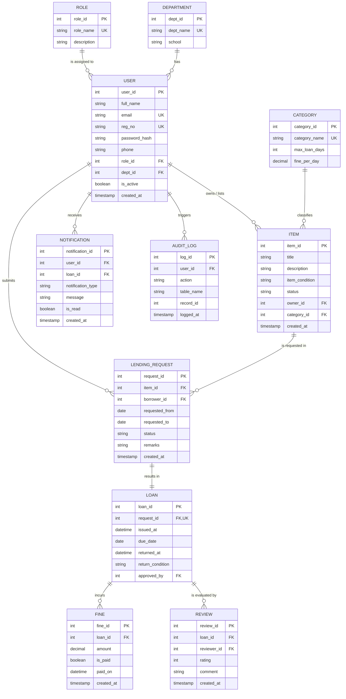

# CampusLend: A Secure, Role-Based Lending and Borrowing Management System for College Campuses

**Course:** BCSE302P – Database Systems Lab  
**Slot:** L25 + L26 | **Faculty:** Dr. V. Sivakumar  
**Academic Year:** Fall Semester 2026-27  
**Assessment:** Lab Internal Assessment 8, 9 & 10 – Final Project Report  

### Team Members
| Name | Register Number | Role & Responsibilities |
|---|---|---|
| **Amani Yadav** | 24BCE0246 | Database design (ER diagram, schema, 3NF normalisation), SQL objects (views, stored procedure, triggers, event), reminder job SQL, backup/restore |
| **Sanjana B S** | 24BCE2516 | Backend APIs and Prisma ORM, JWT & Google OAuth authentication, RBAC middleware, React frontend, Docker, CI/CD, deployment |

---

## 1. Problem Statement
On college campuses, students, faculty, and research labs constantly share valuable physical resources: reference textbooks, scientific calculators, embedded development kits (Arduino, Raspberry Pi, ESP32), sensor modules, sports gear, and project components.

Traditionally, this exchange happens via WhatsApp groups or informal paper registers. This leads to:
- Frequent loss of expensive lab kits and books.
- No systematic due-date tracking or automated reminders.
- Disputes over returned item conditions.
- Zero fine collection for late returns.
- No central audit trail or departmental usage analytics.

**CampusLend** solves this by providing a 3NF normalized relational-database-backed web application where items are cataloged, requested, approved, issued, returned, and reviewed, backed by automatic stored procedures, triggers, audit logging, and automated last-day return notifications.

---

## 2. Entity-Relationship (ER) Diagram



---

## 3. Relational Schema & Normalisation (3NF / BCNF)

### 3.1 Relational Schema
1. **roles** (`role_id` PK, `role_name`, `description`)
2. **departments** (`dept_id` PK, `dept_name`, `school`)
3. **categories** (`category_id` PK, `category_name`, `max_loan_days`, `fine_per_day`)
4. **users** (`user_id` PK, `full_name`, `email`, `reg_no`, `password_hash`, `phone`, `role_id` FK → roles, `dept_id` FK → departments, `is_active`, `created_at`)
5. **items** (`item_id` PK, `title`, `description`, `item_condition`, `status`, `owner_id` FK → users, `category_id` FK → categories, `created_at`)
6. **lending_requests** (`request_id` PK, `item_id` FK → items, `borrower_id` FK → users, `requested_from`, `requested_to`, `status`, `remarks`, `created_at`)
7. **loans** (`loan_id` PK, `request_id` FK UNIQUE → lending_requests, `issued_at`, `due_date`, `returned_at`, `return_condition`, `approved_by` FK → users)
8. **fines** (`fine_id` PK, `loan_id` FK → loans, `amount`, `is_paid`, `paid_on`, `created_at`)
9. **reviews** (`review_id` PK, `loan_id` FK → loans, `reviewer_id` FK → users, `rating`, `comment`, `created_at`)
10. **notifications** (`notification_id` PK, `user_id` FK → users, `loan_id` FK → loans, `notification_type`, `message`, `is_read`, `created_at`)
11. **audit_logs** (`log_id` PK, `user_id` FK → users, `action`, `table_name`, `record_id`, `logged_at`)

### 3.2 Normalisation Proof
- **First Normal Form (1NF):** All attributes contain strictly atomic, scalar values (no repeating groups, multi-valued attributes, or comma-separated lists).
- **Second Normal Form (2NF):** All tables possess a single-attribute surrogate Primary Key (`id`). Hence, partial functional dependencies do not exist ($\forall X \rightarrow Y$, $X$ is the entire primary key).
- **Third Normal Form (3NF):** Transitive dependencies are eliminated:
  - Role permissions are located in `roles`, not duplicated in `users`.
  - Department information resides in `departments`, not in `users`.
  - Fine rates and maximum loan windows are tied to `categories`, not duplicated in `items` or `loans`.
  - Borrower metadata is referenced via `lending_requests`, avoiding duplicate user rows in `loans`.
- **Boyce-Codd Normal Form (BCNF):** For every non-trivial functional dependency $X \rightarrow Y$, $X$ is a superkey/candidate key.

---

## 4. Key Database Objects & SQL Code

### 4.1 Stored Procedure: `sp_return_loan`
Calculates overdue days, charges fine automatically based on category rate, and updates return status.
```sql
DELIMITER $$
CREATE PROCEDURE sp_return_loan(IN p_loan_id INT, IN p_condition VARCHAR(10))
BEGIN
  DECLARE v_due DATE;
  DECLARE v_rate DECIMAL(6,2);
  DECLARE v_days INT;

  SELECT l.due_date, c.fine_per_day INTO v_due, v_rate
  FROM loans l
  JOIN lending_requests r ON r.request_id = l.request_id
  JOIN items i ON i.item_id = r.item_id
  JOIN categories c ON c.category_id = i.category_id
  WHERE l.loan_id = p_loan_id;

  UPDATE loans 
  SET returned_at = NOW(), return_condition = p_condition
  WHERE loan_id = p_loan_id;

  SET v_days = GREATEST(DATEDIFF(CURDATE(), v_due), 0);
  IF v_days > 0 THEN
    INSERT INTO fines(loan_id, amount) VALUES (p_loan_id, v_days * v_rate);
  END IF;
END$$
DELIMITER ;
```

### 4.2 Database Triggers
```sql
-- Trigger 1: Automatically reset item status to AVAILABLE and log audit entry
DELIMITER $$
CREATE TRIGGER trg_loan_returned
AFTER UPDATE ON loans FOR EACH ROW
BEGIN
  IF NEW.returned_at IS NOT NULL AND OLD.returned_at IS NULL THEN
    UPDATE items SET status = 'AVAILABLE'
    WHERE item_id = (SELECT item_id FROM lending_requests WHERE request_id = NEW.request_id);

    INSERT INTO audit_logs(action, table_name, record_id)
    VALUES ('RETURNED', 'loans', NEW.loan_id);
  END IF;
END$$
DELIMITER ;

-- Trigger 2: Prevent lending request if item is not available or borrower has unpaid fines > Rs. 100
DELIMITER $$
CREATE TRIGGER trg_validate_request
BEFORE INSERT ON lending_requests FOR EACH ROW
BEGIN
  DECLARE v_item_status VARCHAR(15);
  DECLARE v_unpaid_fines DECIMAL(8,2);

  SELECT status INTO v_item_status FROM items WHERE item_id = NEW.item_id;
  IF v_item_status != 'AVAILABLE' THEN
    SIGNAL SQLSTATE '45000'
    SET MESSAGE_TEXT = 'Item is not currently available for lending';
  END IF;

  SELECT IFNULL(SUM(f.amount), 0) INTO v_unpaid_fines
  FROM fines f
  JOIN loans l ON l.loan_id = f.loan_id
  JOIN lending_requests r ON r.request_id = l.request_id
  WHERE r.borrower_id = NEW.borrower_id AND f.is_paid = FALSE;

  IF v_unpaid_fines > 100.00 THEN
    SIGNAL SQLSTATE '45000'
    SET MESSAGE_TEXT = 'Cannot request item: you have outstanding unpaid fines exceeding Rs. 100';
  END IF;
END$$
DELIMITER ;
```

### 4.3 Database Views
```sql
-- View 1: Overdue Loans
CREATE VIEW v_overdue_loans AS
SELECT 
  l.loan_id,
  u.full_name AS borrower_name,
  u.email AS borrower_email,
  i.title AS item_title,
  l.due_date,
  DATEDIFF(CURDATE(), l.due_date) AS days_overdue,
  ROUND(DATEDIFF(CURDATE(), l.due_date) * c.fine_per_day, 2) AS accrued_fine
FROM loans l
JOIN lending_requests r ON r.request_id = l.request_id
JOIN users u ON u.user_id = r.borrower_id
JOIN items i ON i.item_id = r.item_id
JOIN categories c ON c.category_id = i.category_id
WHERE l.returned_at IS NULL AND l.due_date < CURDATE();

-- View 2: Item Availability Catalogue
CREATE VIEW v_item_availability AS
SELECT 
  i.item_id,
  i.title,
  i.item_condition,
  i.status,
  c.category_name,
  c.max_loan_days,
  c.fine_per_day,
  u.full_name AS owner_name,
  d.dept_name AS owner_dept
FROM items i
JOIN categories c ON c.category_id = i.category_id
JOIN users u ON u.user_id = i.owner_id
LEFT JOIN departments d ON d.dept_id = u.dept_id
WHERE i.status = 'AVAILABLE';
```

---

## 5. Analytical Aggregate Queries & Joins

### 5.1 Active Loans with Full Relation Hierarchy
```sql
SELECT l.loan_id, i.title, b.full_name AS borrower, o.full_name AS owner, l.due_date
FROM loans l
JOIN lending_requests r ON r.request_id = l.request_id
JOIN items i ON i.item_id = r.item_id
JOIN users b ON b.user_id = r.borrower_id
JOIN users o ON o.user_id = i.owner_id
WHERE l.returned_at IS NULL;
```

### 5.2 Top 5 Most Borrowed Items (GROUP BY & ORDER BY)
```sql
SELECT i.title, COUNT(*) AS times_borrowed
FROM loans l
JOIN lending_requests r ON r.request_id = l.request_id
JOIN items i ON i.item_id = r.item_id
GROUP BY i.title
ORDER BY times_borrowed DESC
LIMIT 5;
```

### 5.3 Department-wise Unpaid Fines (HAVING clause)
```sql
SELECT d.dept_name, SUM(f.amount) AS pending_fines
FROM fines f
JOIN loans l ON l.loan_id = f.loan_id
JOIN lending_requests r ON r.request_id = l.request_id
JOIN users u ON u.user_id = r.borrower_id
JOIN departments d ON d.dept_id = u.dept_id
WHERE f.is_paid = FALSE
GROUP BY d.dept_name
HAVING SUM(f.amount) > 0;
```

---

## 6. Last-Day Return Reminder Job Architecture
Every morning at **08:00 IST**, a scheduled `node-cron` background job runs automatically without manual intervention.

### Logic Flow:
1. Finds active loans where `returned_at IS NULL` and `due_date = CURDATE()`.
2. Inserts a `DUE_TODAY` record into `notifications` for each borrower.
3. A MySQL unique composite index `UNIQUE KEY uq_notif_loan_type (loan_id, notification_type)` prevents duplicate alerts even if the cron job is re-triggered.
4. On the frontend, an unread-count badge lights up on the navigation bell, and a prominent warning banner is displayed across the user's dashboard.
5. In the Admin panel, instructors can trigger this job on-demand for live lab demonstrations via `POST /api/admin/run-reminders`.

---

## 7. Role-Based Access Control (RBAC) Matrix

All users are unified in a single `users` table referencing `roles`:

| Feature / Resource | STUDENT | STAFF (Faculty / Lab In-Charge) | ADMIN |
|---|:---:|:---:|:---:|
| Browse Catalogue & Search | ✅ | ✅ | ✅ |
| Request Item Borrowing | ✅ | ❌ | ❌ |
| View Own Requests & Loans | ✅ | ✅ | ✅ |
| Add / List New Items | ❌ | ✅ | ✅ |
| Approve / Reject Requests (Atomic Transaction) | ❌ | ✅ | ✅ |
| Process Loan Returns (`sp_return_loan`) | ❌ | ✅ | ✅ |
| Settle & Mark Fines as Paid | ❌ | ❌ | ✅ |
| User Directory & Role Assignment | ❌ | ❌ | ✅ |
| Audit Logs & Aggregate Analytics | ❌ | ❌ | ✅ |

---

## 8. Backup and Recovery Verification

### Command Execution:
```bash
# 1. Create full logical backup (includes triggers, stored procedures, events)
mysqldump -u root -p --routines --triggers --events --single-transaction campuslend > backups/campuslend_backup.sql

# 2. Restore into a new database verification instance
mysql -u root -p -e "CREATE DATABASE campuslend_restored;"
mysql -u root -p campuslend_restored < backups/campuslend_backup.sql

# 3. Verification row-count audit
mysql -u root -p -e "
  SELECT 'Original' as db, COUNT(*) as user_count FROM campuslend.users
  UNION ALL
  SELECT 'Restored' as db, COUNT(*) as user_count FROM campuslend_restored.users;
"
```

---

## 9. VTOP Submission & Lab Assessment Checklist

- [x] **Project Details:** Registered student names (Amani Yadav 24BCE0246 & Sanjana B S 24BCE2516), Course Code BCSE302P, Slot L25+L26 present on all source code and documents.
- [x] **Relational Schema:** 11 Normalized 3NF tables with Primary Keys, Foreign Keys, and CHECK constraints.
- [x] **SQL Objects:** Views (`v_overdue_loans`, `v_item_availability`), Stored Procedure (`sp_return_loan`), Triggers (`trg_loan_returned`, `trg_validate_request`), and Event (`ev_last_day_reminder`).
- [x] **Transactions:** `prisma.$transaction` atomic approval (Request status → Loan creation → Item status change).
- [x] **Automated Scheduler:** Daily 08:00 IST return reminder via `node-cron`.
- [x] **DevOps & Containers:** Dockerfile for Backend and Frontend, `docker-compose.yml`, and GitHub Actions CI/CD workflow (`ci-cd.yml`).
- [x] **Automated Testing:** Native Node test runner suite verifying auth, RBAC permissions, and fine calculations (6/6 tests passing).
